# World Collection

[](https://github.com/mertgulerx/world-collection/stargazers)
[](https://github.com/mertgulerx/world-collection/blob/main/LICENSE)

[](https://doi.org/10.5281/zenodo.23460686)

42 Gazebo Harmonic simulation worlds for testing robot exploration, navigation, SLAM and many more.

> [!NOTE]
> New environments with 3D models and textures required for **Agentic Workflows, Perception, 3D Mapping, Object Detection and Worker Robot Training** will be added in the future.

The collection includes simple test layouts, mazes, offices, warehouses, forests, real places and worlds with moving obstacles. Each world has fixed start poses and measured values, so methods can be compared fairly.

<p align="center">
  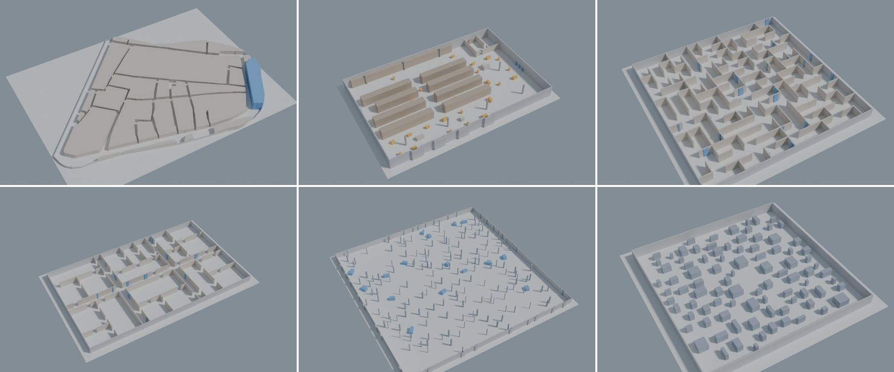
  <br>
  <sub>El Born, Barcelona (RP3) · warehouse with moving objects (MO2) · maze (F1-06) · office floor (F2-08) · walled forest (F4-03) · clutter field (SC7b)</sub>
</p>

The worlds are plain SDF files with no robot inside, so they work with any robot and stack. They were made for the [exploration benchmark](https://github.com/mertgulerx/autonomous-exploration-demo-benchmark) of [frontier_exploration_ros2](https://github.com/mertgulerx/frontier_exploration_ros2), but nothing in them depends on it.

## Contents

- [Picking a world](#picking-a-world)
- [Single-challenge worlds (SC)](#single-challenge-worlds-sc)
- [Pilot worlds (P)](#pilot-worlds-p)
- [Generated families (F)](#generated-families-f)
- [Real places (RP)](#real-places-rp)
- [Moving objects (MO)](#moving-objects-mo)
- [Quick start](#quick-start)
- [Technical notes](#technical-notes)
- [License](#license)
- [Maintainer](#maintainer)

## Picking a world

- **Isolating one problem:** the SC worlds. They are small, and each one targets a single situation.
- **Tuning parameters:** the two pilot worlds, so the worlds you report on are not used for tuning.
- **Studying how a method scales:** an F family. Its worlds change one thing at a time, such as size, number of rooms or density.
- **Realistic layouts:** RP1, RP2 or RP3.
- **Dynamic obstacles:** an MO world and its static twin.

Click a thumbnail for the full 3D render, or "plan" for the top-down map with the start poses and the narrowest spot marked in red. In the tables, **free area** is the floor the robot can actually reach, and **narrowest** is the tightest gap it has to pass somewhere in the world. **Loops** are routes that go around a large obstacle and come back. **Dead ends** are places that can only be left the way they were entered; a room with one door counts as one.

<p align="right"><a href="#world-collection">back to top</a></p>

## Single-challenge worlds (SC)

Ten small worlds, each built around one thing that makes exploration or navigation hard. Each has three start poses, so you can also see how much the start matters.

<table>
  <tr>
    <td align="center"><a href="worlds/SC1_square_loop/review/render_overview.png">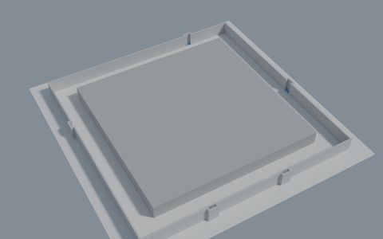</a><br><b>SC1</b> · <a href="worlds/SC1_square_loop/review/plan.png">plan</a></td>
    <td align="center"><a href="worlds/SC2a_narrow_passage_1m2/review/render_overview.png">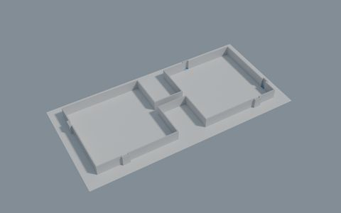</a><br><b>SC2a</b> · <a href="worlds/SC2a_narrow_passage_1m2/review/plan.png">plan</a></td>
    <td align="center"><a href="worlds/SC2b_narrow_passage_2m0/review/render_overview.png">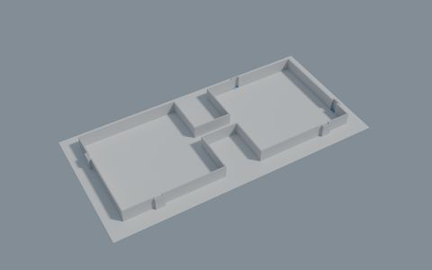</a><br><b>SC2b</b> · <a href="worlds/SC2b_narrow_passage_2m0/review/plan.png">plan</a></td>
  </tr>
  <tr>
    <td align="center"><a href="worlds/SC3_dead_end_comb/review/render_overview.png">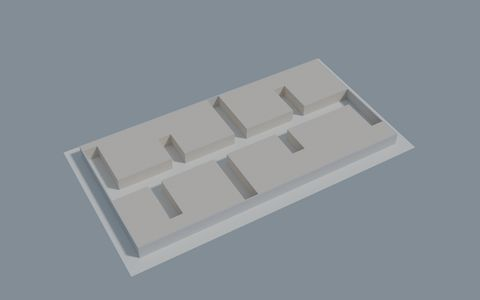</a><br><b>SC3</b> · <a href="worlds/SC3_dead_end_comb/review/plan.png">plan</a></td>
    <td align="center"><a href="worlds/SC4_office_strip/review/render_overview.png">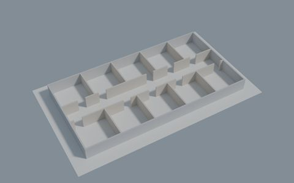</a><br><b>SC4</b> · <a href="worlds/SC4_office_strip/review/plan.png">plan</a></td>
    <td align="center"><a href="worlds/SC5_nested_pockets/review/render_overview.png">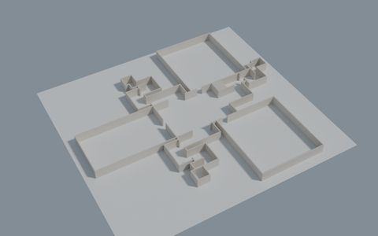</a><br><b>SC5</b> · <a href="worlds/SC5_nested_pockets/review/plan.png">plan</a></td>
  </tr>
  <tr>
    <td align="center"><a href="worlds/SC6_open_hall/review/render_overview.png">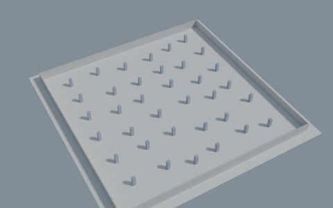</a><br><b>SC6</b> · <a href="worlds/SC6_open_hall/review/plan.png">plan</a></td>
    <td align="center"><a href="worlds/SC7a_clutter_field_low/review/render_overview.png">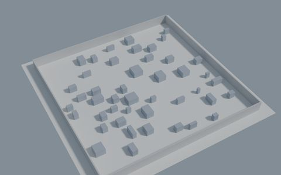</a><br><b>SC7a</b> · <a href="worlds/SC7a_clutter_field_low/review/plan.png">plan</a></td>
    <td align="center"><a href="worlds/SC7b_clutter_field_high/review/render_overview.png">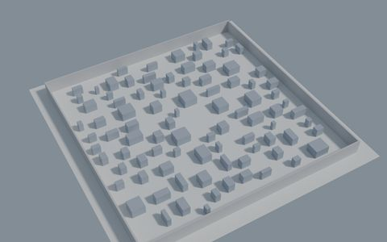</a><br><b>SC7b</b> · <a href="worlds/SC7b_clutter_field_high/review/plan.png">plan</a></td>
  </tr>
  <tr>
    <td align="center"><a href="worlds/SC8_zigzag/review/render_overview.png">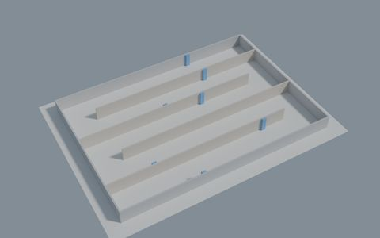</a><br><b>SC8</b> · <a href="worlds/SC8_zigzag/review/plan.png">plan</a></td>
  </tr>
</table>

| World | Folder                    | The challenge                      | Free area (m²) | Narrowest (m) | Loops | Dead ends |
| ----- | ------------------------- | ---------------------------------- | -------------: | ------------: | ----: | --------: |
| SC1   | `SC1_square_loop`         | A loop                             |            326 |           3.0 |     1 |         0 |
| SC2a  | `SC2a_narrow_passage_1m2` | A 1.2 m corridor between two halls |            459 |           1.2 |     0 |         2 |
| SC2b  | `SC2b_narrow_passage_2m0` | The same with a 2.0 m corridor     |            464 |           2.0 |     0 |         2 |
| SC3   | `SC3_dead_end_comb`       | Eight dead-end branches            |            222 |           2.0 |     0 |         8 |
| SC4   | `SC4_office_strip`        | Ten rooms off a corridor           |            330 |           1.2 |     0 |        10 |
| SC5   | `SC5_nested_pockets`      | Wide openings, small rooms behind  |            908 |           1.2 |     0 |         8 |
| SC6   | `SC6_open_hall`           | 36 pillars in a 40 × 40 m hall     |          1,587 |           3.7 |     0 |         0 |
| SC7a  | `SC7a_clutter_field_low`  | 45 blocks in a 30 × 30 m field     |            834 |           1.0 |     6 |         0 |
| SC7b  | `SC7b_clutter_field_high` | 90 blocks in the same field        |            786 |          0.98 |     8 |         0 |
| SC8   | `SC8_zigzag`              | One long folded corridor           |            602 |           3.7 |     0 |         2 |

**SC1, square loop.** With a lidar the robot only sees part of one side, so it has to pick a direction and later decide whether to keep going round or turn back. It shows unnecessary U-turns, and it is a simple loop for checking whether SLAM closes it when the robot returns to the start.

**SC2a and SC2b, narrow passage.** Two halls joined by a short corridor. The only difference between the two worlds is the corridor width: 1.2 m in SC2a and 2.0 m in SC2b. For a navigation stack, the first question is whether the planner fits through at all: with a costmap inflation radius around 0.8 m, the whole 1.2 m corridor lies inside inflated cost, while the 2.0 m one keeps a free strip down the middle. For an explorer, run both and compare how much later it reaches the far hall and how long it hesitates at the corridor's mouth.

**SC3, dead-end comb.** A spine with eight branches, every one of them a dead end. The inside of a branch is only visible from its mouth, and the robot always has to come back the way it went in. It shows how much time an explorer spends going in and out of dead ends, and whether it visits them in a sensible order or zigzags along the spine. The branches are 2 m wide, so for a navigation stack it is also a check that the robot can turn around at the end of a narrow dead end.

**SC4, office strip.** It shows whether an explorer finishes each room before moving on or keeps switching sides and coming back later.

**SC5, nested pockets.** Three narrow doors lead straight into large rooms, and three wide openings lead into chains of ever smaller rooms that the lidar can't see from the hall. It shows whether an explorer goes for the big-looking openings or for the doors that hide most of the floor. For navigation, it has narrow corner pockets.

**SC6, open hall.** Like a parking garage. From the middle, a lidar sees only pillars and no walls, and every pillar casts a small shadow that leaves a gap in the map. It shows how an explorer handles many small frontiers spread over open space, and how well scan matching works when the only features are similar-looking pillars.

**SC7a and SC7b, clutter field.** The blocks hide each other, which breaks frontiers into many small pieces. For navigation it tests the local planner and inflation settings in tight gaps.

**SC8, zigzag.** From an end there is only one way to go. From the middle the robot has to pick a half and later come all the way back through the start. Comparing the three start poses shows how much the start position costs an explorer. For a navigation stack it is one long route with four U-turns, a simple way to compare planners on a long goal.

<p align="right"><a href="#world-collection">back to top</a></p>

## Pilot worlds (P)

Two indoor layouts that mix several challenges: rooms, a loop, doors and some open space. They are deliberately different from the SC worlds. Use them to tune parameters, check run times and set up your robot, so the worlds you report results on stay untouched. Each has three start poses.

<table>
  <tr>
    <td align="center"><a href="worlds/P1_racetrack_office/review/render_overview.png">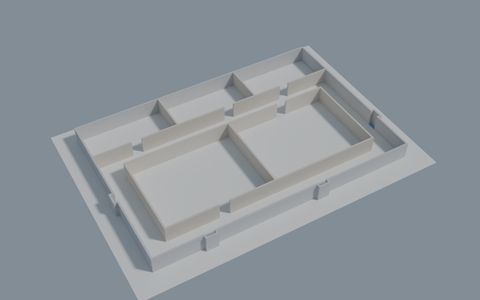</a><br><b>P1</b> · <a href="worlds/P1_racetrack_office/review/plan.png">plan</a></td>
    <td align="center"><a href="worlds/P2_lobby_wing/review/render_overview.png">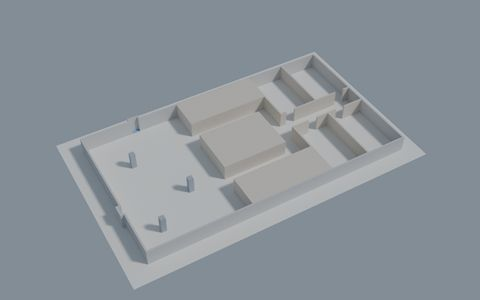</a><br><b>P2</b> · <a href="worlds/P2_lobby_wing/review/plan.png">plan</a></td>
  </tr>
</table>

| World | Folder                | Layout                                                             | Free area (m²) | Narrowest (m) | Loops | Dead ends |
| ----- | --------------------- | ------------------------------------------------------------------ | -------------: | ------------: | ----: | --------: |
| P1    | `P1_racetrack_office` | Corridor ring around two rooms, three more rooms on the north side |            579 |           1.2 |     1 |        10 |
| P2    | `P2_lobby_wing`       | Lobby with pillars, a loop around a core, a wing of four rooms     |            439 |           1.2 |     1 |         4 |

**P1, racetrack office.** The robot chooses a direction round the ring and when to enter each room.

**P2, lobby and wing.** The robot chooses between finishing the lobby first and heading for the wing.

<p align="right"><a href="#world-collection">back to top</a></p>

## Generated families (F)

The families answer a different question: not "can it do this?" but "how does it scale?" Each family comes from a seeded generator and changes a few things in a controlled way, such as size, rooms, doors or density. Running the same method across a family shows what slows it down; two worlds that differ in one setting can be compared directly. Each generated world has one start pose, and every family has a contact sheet showing all its worlds side by side.

### F1 mazes

Grid mazes at two sizes (8 × 8 and 14 × 14 cells, 2.5 m each) with 2.3 m corridors. They are built two ways: a "perfect" maze has exactly one route between any two places and no loops, and a "braid" maze has about half its dead ends opened up into loops. The generator also changes the character: recursive backtracker (`rb`) mazes have long winding corridors, and Kruskal (`kr`) mazes have many short dead ends.

Use them to see how an explorer copes with backtracking as the dead ends go from 3 to 62, and whether loops help it or only add ways to get lost. For navigation, the large mazes give long goals with many turns, and the braid mazes have more than one route to choose from. Because the corridors look alike, mazes are also a good place to look for SLAM errors. [Contact sheet](worlds/F1_family/review/family_contact_sheet.png).

<table>
  <tr>
    <td align="center"><a href="worlds/F1_maze_s08_perfect_rb/review/render_overview.png">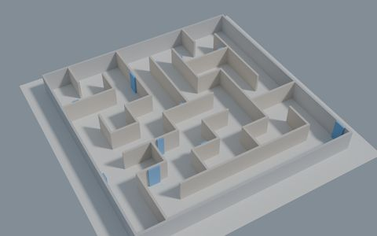</a><br><b>F1-01</b> · <a href="worlds/F1_maze_s08_perfect_rb/review/plan.png">plan</a></td>
    <td align="center"><a href="worlds/F1_maze_s08_perfect_kr/review/render_overview.png">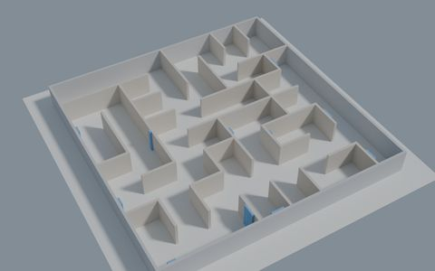</a><br><b>F1-02</b> · <a href="worlds/F1_maze_s08_perfect_kr/review/plan.png">plan</a></td>
    <td align="center"><a href="worlds/F1_maze_s08_braid50_rb/review/render_overview.png">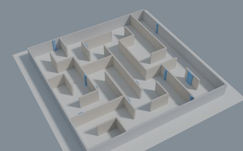</a><br><b>F1-03</b> · <a href="worlds/F1_maze_s08_braid50_rb/review/plan.png">plan</a></td>
  </tr>
  <tr>
    <td align="center"><a href="worlds/F1_maze_s08_braid50_kr/review/render_overview.png">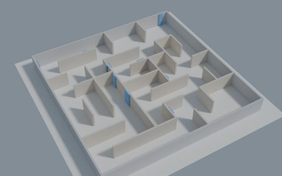</a><br><b>F1-04</b> · <a href="worlds/F1_maze_s08_braid50_kr/review/plan.png">plan</a></td>
    <td align="center"><a href="worlds/F1_maze_s14_perfect_rb/review/render_overview.png">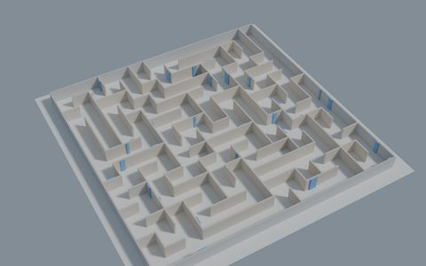</a><br><b>F1-05</b> · <a href="worlds/F1_maze_s14_perfect_rb/review/plan.png">plan</a></td>
    <td align="center"><a href="worlds/F1_maze_s14_perfect_kr/review/render_overview.png">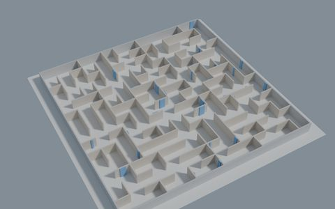</a><br><b>F1-06</b> · <a href="worlds/F1_maze_s14_perfect_kr/review/plan.png">plan</a></td>
  </tr>
  <tr>
    <td align="center"><a href="worlds/F1_maze_s14_braid50_rb/review/render_overview.png">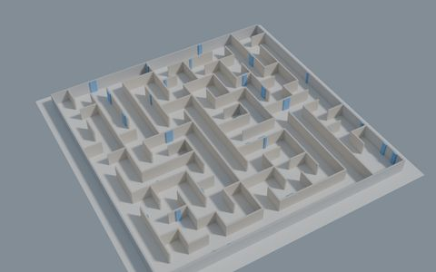</a><br><b>F1-07</b> · <a href="worlds/F1_maze_s14_braid50_rb/review/plan.png">plan</a></td>
    <td align="center"><a href="worlds/F1_maze_s14_braid50_kr/review/render_overview.png">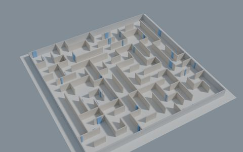</a><br><b>F1-08</b> · <a href="worlds/F1_maze_s14_braid50_kr/review/plan.png">plan</a></td>
  </tr>
</table>

| World | Folder                   | Size    | Type          | Free area (m²) | Loops | Dead ends |
| ----- | ------------------------ | ------- | ------------- | -------------: | ----: | --------: |
| F1-01 | `F1_maze_s08_perfect_rb` | 8 × 8   | perfect, `rb` |            366 |     0 |         7 |
| F1-02 | `F1_maze_s08_perfect_kr` | 8 × 8   | perfect, `kr` |            366 |     0 |        20 |
| F1-03 | `F1_maze_s08_braid50_rb` | 8 × 8   | braid, `rb`   |            369 |     4 |         3 |
| F1-04 | `F1_maze_s08_braid50_kr` | 8 × 8   | braid, `kr`   |            369 |     3 |         9 |
| F1-05 | `F1_maze_s14_perfect_rb` | 14 × 14 | perfect, `rb` |          1,123 |     0 |        23 |
| F1-06 | `F1_maze_s14_perfect_kr` | 14 × 14 | perfect, `kr` |          1,123 |     0 |        62 |
| F1-07 | `F1_maze_s14_braid50_rb` | 14 × 14 | braid, `rb`   |          1,127 |     7 |        12 |
| F1-08 | `F1_maze_s14_braid50_kr` | 14 × 14 | braid, `kr`   |          1,134 |    18 |        17 |

### F2 offices

Office floors of 30 × 20 m or 50 × 30 m with 8 or 20 empty rooms, and either one or two doors per room. Corridors are 2 m wide and doors 1.2 m. With one door, every room is a dead end. With two, every room becomes a shortcut and the floor is full of loops.

These are the worlds for "rooms versus corridors" questions: how exploration time grows from 8 to 20 rooms on the same floor, and whether a second door per room saves time or leads the robot through rooms it has already seen. For navigation, every door is a 1.2 m gap, with up to 40 doorways per floor. [Contact sheet](worlds/F2_family/review/family_contact_sheet.png).

<table>
  <tr>
    <td align="center"><a href="worlds/F2_office_f30x20_r08_d1/review/render_overview.png">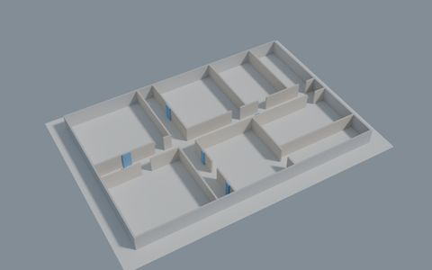</a><br><b>F2-01</b> · <a href="worlds/F2_office_f30x20_r08_d1/review/plan.png">plan</a></td>
    <td align="center"><a href="worlds/F2_office_f30x20_r08_d2/review/render_overview.png">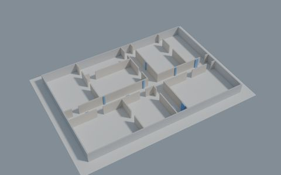</a><br><b>F2-02</b> · <a href="worlds/F2_office_f30x20_r08_d2/review/plan.png">plan</a></td>
    <td align="center"><a href="worlds/F2_office_f30x20_r20_d1/review/render_overview.png">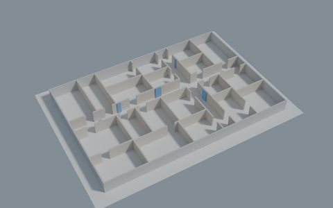</a><br><b>F2-03</b> · <a href="worlds/F2_office_f30x20_r20_d1/review/plan.png">plan</a></td>
  </tr>
  <tr>
    <td align="center"><a href="worlds/F2_office_f30x20_r20_d2/review/render_overview.png">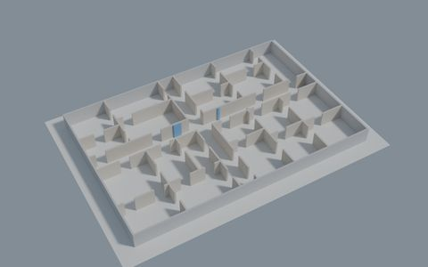</a><br><b>F2-04</b> · <a href="worlds/F2_office_f30x20_r20_d2/review/plan.png">plan</a></td>
    <td align="center"><a href="worlds/F2_office_f50x30_r08_d1/review/render_overview.png">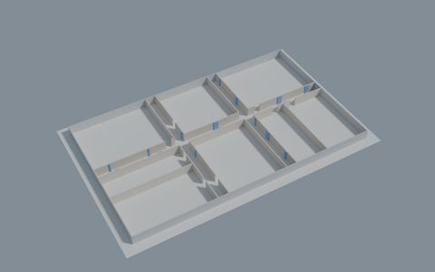</a><br><b>F2-05</b> · <a href="worlds/F2_office_f50x30_r08_d1/review/plan.png">plan</a></td>
    <td align="center"><a href="worlds/F2_office_f50x30_r08_d2/review/render_overview.png">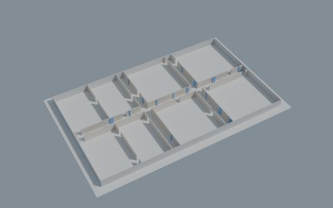</a><br><b>F2-06</b> · <a href="worlds/F2_office_f50x30_r08_d2/review/plan.png">plan</a></td>
  </tr>
  <tr>
    <td align="center"><a href="worlds/F2_office_f50x30_r20_d1/review/render_overview.png">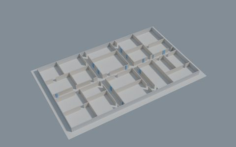</a><br><b>F2-07</b> · <a href="worlds/F2_office_f50x30_r20_d1/review/plan.png">plan</a></td>
    <td align="center"><a href="worlds/F2_office_f50x30_r20_d2/review/render_overview.png"></a><br><b>F2-08</b> · <a href="worlds/F2_office_f50x30_r20_d2/review/plan.png">plan</a></td>
  </tr>
</table>

| World | Folder                    | Floor (m) | Rooms | Doors per room | Free area (m²) |
| ----- | ------------------------- | --------- | ----: | -------------: | -------------: |
| F2-01 | `F2_office_f30x20_r08_d1` | 30 × 20   |     8 |              1 |            575 |
| F2-02 | `F2_office_f30x20_r08_d2` | 30 × 20   |     8 |              2 |            577 |
| F2-03 | `F2_office_f30x20_r20_d1` | 30 × 20   |    20 |              1 |            564 |
| F2-04 | `F2_office_f30x20_r20_d2` | 30 × 20   |    20 |              2 |            569 |
| F2-05 | `F2_office_f50x30_r08_d1` | 50 × 30   |     8 |              1 |          1,453 |
| F2-06 | `F2_office_f50x30_r08_d2` | 50 × 30   |     8 |              2 |          1,455 |
| F2-07 | `F2_office_f50x30_r20_d1` | 50 × 30   |    20 |              1 |          1,432 |
| F2-08 | `F2_office_f50x30_r20_d2` | 50 × 30   |    20 |              2 |          1,437 |

### F3 warehouse aisles

Warehouse halls with long rows of solid racks. The aisles are 1.5 m or 3.0 m wide, with one or three cross-aisles cutting through the rows. Inside an aisle the robot sees only that aisle, so the explorer has to decide which aisle to sweep next and whether to go through them in order.

Narrow and wide aisles show how much a tight squeeze slows down the planner and the explorer; 1.5 m aisles leave little room once the costmap is inflated. One cross-aisle against three shows whether shortcuts help. F3-03 and F3-05 use the same aisle settings in two hall sizes. The aisles look alike, so a few small recesses in the rack faces act as landmarks, and the worlds are a useful check of whether SLAM confuses one aisle with another. [Contact sheet](worlds/F3_family/review/family_contact_sheet.png).

<table>
  <tr>
    <td align="center"><a href="worlds/F3_aisles_h30x20_a150_x1/review/render_overview.png">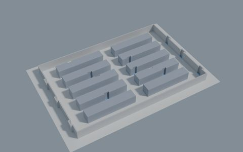</a><br><b>F3-01</b> · <a href="worlds/F3_aisles_h30x20_a150_x1/review/plan.png">plan</a></td>
    <td align="center"><a href="worlds/F3_aisles_h30x20_a150_x3/review/render_overview.png">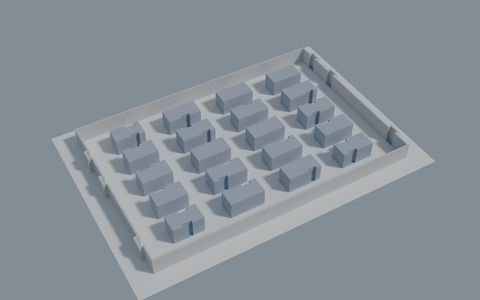</a><br><b>F3-02</b> · <a href="worlds/F3_aisles_h30x20_a150_x3/review/plan.png">plan</a></td>
    <td align="center"><a href="worlds/F3_aisles_h30x20_a300_x1/review/render_overview.png">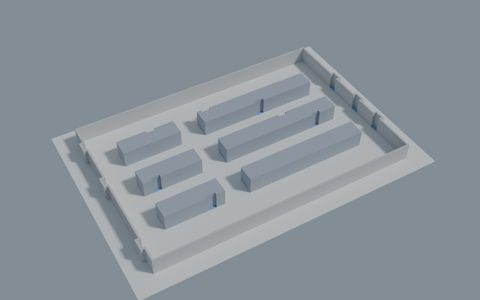</a><br><b>F3-03</b> · <a href="worlds/F3_aisles_h30x20_a300_x1/review/plan.png">plan</a></td>
  </tr>
  <tr>
    <td align="center"><a href="worlds/F3_aisles_h30x20_a300_x3/review/render_overview.png">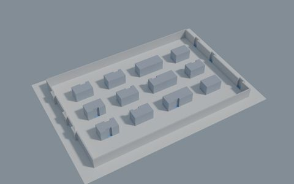</a><br><b>F3-04</b> · <a href="worlds/F3_aisles_h30x20_a300_x3/review/plan.png">plan</a></td>
    <td align="center"><a href="worlds/F3_aisles_h60x40_a300_x1/review/render_overview.png">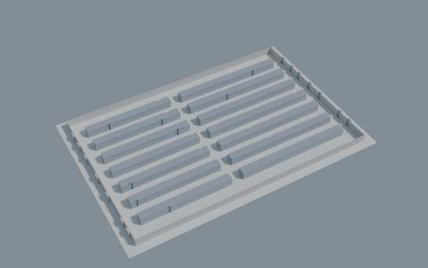</a><br><b>F3-05</b> · <a href="worlds/F3_aisles_h60x40_a300_x1/review/plan.png">plan</a></td>
  </tr>
</table>

| World | Folder                     | Hall (m) | Aisle width (m) | Cross-aisles | Free area (m²) |
| ----- | -------------------------- | -------- | --------------: | -----------: | -------------: |
| F3-01 | `F3_aisles_h30x20_a150_x1` | 30 × 20  |             1.5 |            1 |            395 |
| F3-02 | `F3_aisles_h30x20_a150_x3` | 30 × 20  |             1.5 |            3 |            459 |
| F3-03 | `F3_aisles_h30x20_a300_x1` | 30 × 20  |             3.0 |            1 |            479 |
| F3-04 | `F3_aisles_h30x20_a300_x3` | 30 × 20  |             3.0 |            3 |            515 |
| F3-05 | `F3_aisles_h60x40_a300_x1` | 60 × 40  |             3.0 |            1 |          1,696 |

### F4 walled forests

Open, unstructured space: tree trunks scattered inside a wall, with a few boulders as landmarks and no inner walls. The forests are 40 or 80 m across, with 0.01 or 0.03 trunks per m², and trunks are always at least 1 m apart. Frontiers are everywhere at once, so there are no corridors for an explorer to follow.

In a sparse forest most lidar beams pass between the trunks; in a dense one, nearby trunks hide the ones behind. Compare F4-02 and F4-03 (same size, different density) or F4-01 and F4-03 (same density, different size). For a navigation stack, the forests are a long slalom where the tightest gaps are about 1 m. [Contact sheet](worlds/F4_family/review/family_contact_sheet.png).

<table>
  <tr>
    <td align="center"><a href="worlds/F4_forest_s40_d003/review/render_overview.png">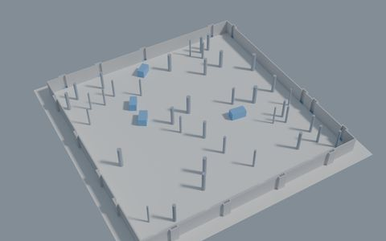</a><br><b>F4-01</b> · <a href="worlds/F4_forest_s40_d003/review/plan.png">plan</a></td>
    <td align="center"><a href="worlds/F4_forest_s80_d001/review/render_overview.png">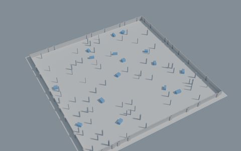</a><br><b>F4-02</b> · <a href="worlds/F4_forest_s80_d001/review/plan.png">plan</a></td>
    <td align="center"><a href="worlds/F4_forest_s80_d003/review/render_overview.png">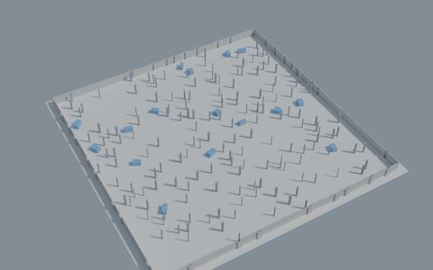</a><br><b>F4-03</b> · <a href="worlds/F4_forest_s80_d003/review/plan.png">plan</a></td>
  </tr>
</table>

| World | Folder               | Size (m) | Trunks per m² | Free area (m²) | Narrowest (m) |
| ----- | -------------------- | -------- | ------------: | -------------: | ------------: |
| F4-01 | `F4_forest_s40_d003` | 40 × 40  |          0.03 |          1,582 |           1.1 |
| F4-02 | `F4_forest_s80_d001` | 80 × 80  |          0.01 |          6,335 |          1.04 |
| F4-03 | `F4_forest_s80_d003` | 80 × 80  |          0.03 |          6,311 |           0.9 |

### F5 walled city blocks

A 100 × 100 m walled town: a 4 × 4 grid of 17.5 m buildings with 6 m streets. Three blocks are left empty as plazas, each with a monument in the middle. Every building is an island, so there are loops everywhere, long straight façades that look alike, and plazas wider than a typical lidar range. Runs are long. It is a stress test for an explorer's route planning, gives a navigation stack goals 100 m or more away with many possible routes, and shows how much SLAM drifts over a long drive. [Contact sheet](worlds/F5_family/review/family_contact_sheet.png).

<table>
  <tr>
    <td align="center"><a href="worlds/F5_urban_w06_b15/review/render_overview.png">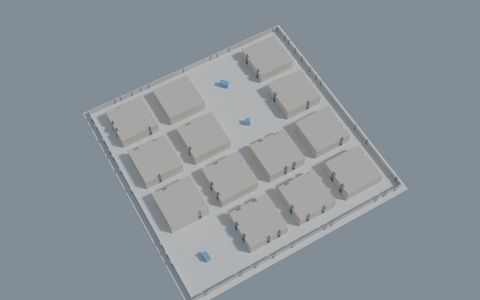</a><br><b>F5-01</b> · <a href="worlds/F5_urban_w06_b15/review/plan.png">plan</a></td>
  </tr>
</table>

| World | Folder             | Size (m)  | Free area (m²) | Narrowest (m) | Loops |
| ----- | ------------------ | --------- | -------------: | ------------: | ----: |
| F5-01 | `F5_urban_w06_b15` | 100 × 100 |          6,112 |          5.98 |    16 |

<p align="right"><a href="#world-collection">back to top</a></p>

## Real places (RP)

Designed worlds are good at isolating one problem. These three check whether what was learned there holds up in more realistic layouts. Each has three start poses.

<table>
  <tr>
    <td align="center"><a href="worlds/RP1_aces3_austin/review/render_overview.png">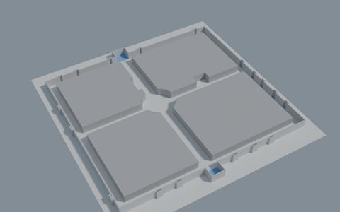</a><br><b>RP1</b> · <a href="worlds/RP1_aces3_austin/review/plan.png">plan</a></td>
    <td align="center"><a href="worlds/RP2_industrial_warehouse/review/render_overview.png">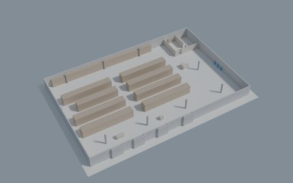</a><br><b>RP2</b> · <a href="worlds/RP2_industrial_warehouse/review/plan.png">plan</a></td>
    <td align="center"><a href="worlds/RP3_santa_maria_del_mar/review/render_overview.png">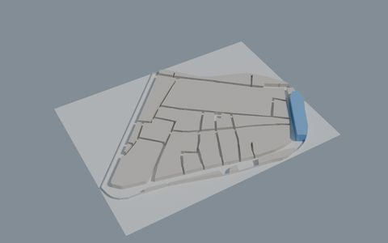</a><br><b>RP3</b> · <a href="worlds/RP3_santa_maria_del_mar/review/plan.png">plan</a></td>
  </tr>
</table>

| World | Folder                     | What it is                                        | Free area (m²) | Narrowest (m) | Loops | Dead ends |
| ----- | -------------------------- | ------------------------------------------------- | -------------: | ------------: | ----: | --------: |
| RP1   | `RP1_aces3_austin`         | A real office floor known from SLAM papers        |            556 |           1.8 |     4 |         3 |
| RP2   | `RP2_industrial_warehouse` | A working warehouse: racks, loading docks, office |          1,673 |           1.2 |    10 |         5 |
| RP3   | `RP3_santa_maria_del_mar`  | The streets of El Born, Barcelona                 |          9,108 |          1.34 |    16 |         7 |

**RP1, ACES3 Austin.** The third floor of the ACES building at the University of Texas at Austin. Use it to check whether results from the designed worlds carry over to a real floor plan, and to try loop closure on a well-known layout. The outer ring is only 1.8 m wide, which also makes it a test for corridor driving.

**RP2, industrial warehouse.** A 56 × 36 m warehouse with rack aisles, a loading-dock staging area, an open zone in the east and a small two-room office. The robot has to choose the order of similar aisles, when to cross between them, and when to visit the office.

**RP3, Santa Maria del Mar.** A simplified model of the streets of El Born in Barcelona, around the basilica of Santa Maria del Mar. Streets are 2 to 6 m wide and irregular, with oblique junctions and a few small squares, and the view rarely reaches more than a few tens of metres ahead. It is the only street network here that is not a grid, and the largest world at over 9,000 m². It suits long-range route planning and narrow navigation.

<p align="right"><a href="#world-collection">back to top</a></p>

## Moving objects (MO)

Two worlds with solid moving obstacles: boxes, small cylinders, carts and pallet trucks moving at 0.35 to 0.95 m/s. They follow fixed routes that depend only on simulation time, so every run sees exactly the same traffic. They collide with the robot and its lidar sees them, but they do not react to it.

The static part of each world is identical to a base world, SC4 for MO1 and RP2 for MO2. Running the same method in both shows what the moving objects cost. For navigation these are dynamic obstacle avoidance tests; for SLAM they show what happens to the map when things move through it. These worlds need the [moving-object plugin](#the-moving-object-plugin).

<table>
  <tr>
    <td align="center"><a href="worlds/MO1_office_strip_moving/review/render_overview.png">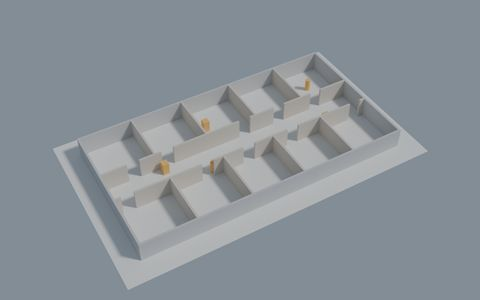</a><br><b>MO1</b> · <a href="worlds/MO1_office_strip_moving/review/plan.png">plan</a></td>
    <td align="center"><a href="worlds/MO2_warehouse_moving/review/render_overview.png"></a><br><b>MO2</b> · <a href="worlds/MO2_warehouse_moving/review/plan.png">plan</a></td>
  </tr>
</table>

| World | Folder                    | Static twin | Moving objects | Free area (m²) |
| ----- | ------------------------- | ----------- | -------------: | -------------: |
| MO1   | `MO1_office_strip_moving` | SC4         |              5 |            330 |
| MO2   | `MO2_warehouse_moving`    | RP2         |             28 |          1,673 |

**MO1, office strip.** Five objects patrol SC4's corridor and visit rooms. They hide doors and rooms from the lidar, and an object passing through a door blocks that room's only entrance for a few seconds. It shows whether an explorer waits, reroutes or gives up on the room.

**MO2, warehouse.** RP2 with 28 objects: convoys of pallet trucks, carts and boxes circulate in the staging area and the east zone, and others patrol the aisles, the cross aisle and the north aisle. The traffic keeps the local planner busy, and moving objects between rows of similar racks are a good test for scan matching.
Very extreme scenario because there are a lot of moving objects.

<p align="right"><a href="#world-collection">back to top</a></p>

## Quick start

Requirements: Gazebo Harmonic (included with ROS 2 Jazzy). Run the commands from this folder.

Open a world:

```bash
gz sim worlds/SC1_square_loop/SC1_square_loop.sdf
```

Start it from ROS 2 and spawn your robot at one of the world's start poses. Each world lists them under `spawns` in its `world.yaml`, and the world name is the folder name in lower case:

```bash
ros2 launch ros_gz_sim gz_sim.launch.py gz_args:="-r worlds/SC1_square_loop/SC1_square_loop.sdf"

# SC1, spawn S1: x 0.0, y -13.5, yaw 0.0
ros2 run ros_gz_sim create -world sc1_square_loop -topic robot_description -name my_robot \
  -x 0.0 -y -13.5 -z 0.05 -Y 0.0
```

Bridge the clock and your sensors (topic names depend on your robot), then start SLAM, Nav2 or your explorer with `use_sim_time:=true`:

```bash
ros2 run ros_gz_bridge parameter_bridge \
  /clock@rosgraph_msgs/msg/Clock[gz.msgs.Clock \
  /scan@sensor_msgs/msg/LaserScan[gz.msgs.LaserScan
```

The worlds already load the sensor, IMU and contact systems, so your robot's lidar and cameras work as they are. The two moving-object worlds need one extra plugin; see [Moving objects](#the-moving-object-plugin).

<p align="right"><a href="#world-collection">back to top</a></p>

## Technical notes

### Coordinates and start poses

Start poses are in metres, yaw in radians, in the world frame (x east, y north, z up). The floor's top face is at z = 0, and every start pose has at least 0.5 m of free space around it. The SDF files are SDF 1.9 for Gazebo Harmonic (gz-sim 8) and load the Physics, Sensors (ogre2), IMU, Contact, UserCommands and SceneBroadcaster systems.

### What's in a world folder

```text
worlds/<ID>_<name>/
├── <ID>_<name>.sdf     the world
├── world.yaml          start poses, measured values and metadata
├── LICENSE             Apache-2.0
├── NOTICE              RP1 only
└── review/             plan.png, render_overview.png, render_top.png and the build checks
```

The main `world.yaml` keys:

| Key                    | What it holds                                                                                |
| ---------------------- | -------------------------------------------------------------------------------------------- |
| `spawns`               | Start poses: `id`, `x`, `y`, `yaw`                                                           |
| `measured`             | Free area, narrowest passage and loop count, measured on the built world                     |
| `descriptors`          | More measured values: dead ends, junctions, clearance, how much a 10 m lidar sees on average |
| `inclusion`, `notches` | The outline of the area to explore, and the wall recesses inside it                          |
| `doors`                | Doors, in worlds that have them                                                              |
| `moving_objects`       | MO worlds only: each object's shape, route, speed and timing                                 |
| `parameters`, `seed`   | For generated worlds, the settings and seed they came from                                   |
| `sources`, `licence`   | Where the layout idea came from, and the licence                                             |

Free area is measured on a 0.05 m grid from obstacles between 0.03 and 0.35 m above the floor, and counts only the part reachable from the first start pose.

### The moving-object plugin

The MO worlds use a small Gazebo system plugin to move the objects. Build it once with ROS 2 Jazzy and its Gazebo packages:

```bash
source /opt/ros/jazzy/setup.bash
cmake -S plugins/moving_objects -B plugins/moving_objects/build
cmake --build plugins/moving_objects/build
cmake --install plugins/moving_objects/build
```

This writes the library to `plugins/lib/`. Put that folder on Gazebo's plugin path and open the world:

```bash
export GZ_SIM_SYSTEM_PLUGIN_PATH="$PWD/plugins/lib:${GZ_SIM_SYSTEM_PLUGIN_PATH}"
gz sim worlds/MO1_office_strip_moving/MO1_office_strip_moving.sdf
```

The plugin publishes the true pose of every object at 20 Hz (simulation time) on `/benchmark/moving_objects/pose` as `gz.msgs.Pose_V`, for example to measure how close the robot came to each object. Bridge it to ROS 2 with:

```bash
ros2 run ros_gz_bridge parameter_bridge \
  /benchmark/moving_objects/pose@tf2_msgs/msg/TFMessage[gz.msgs.Pose_V
```

If a world has an invalid object setting, the plugin logs which object and field, and nothing moves. More in [plugins/moving_objects/README.md](plugins/moving_objects/README.md).

### Regenerating the worlds

Every world is defined in Python and generated by the `worldgen` package in this folder. It is not needed to use the worlds. To rebuild one, use Python 3.12 with numpy 2.2.6, scipy 1.15.3, matplotlib 3.10.3 and PyYAML 6.0.2, plus `gz sdf` from ROS 2 Jazzy for the parse check (and Blender 4.5 for the 3D renders):

```bash
python -m worldgen build SC1          # rebuild a world, run its checks, draw plan.png
python -m worldgen build F1-01       # family worlds go by their own id
python -m worldgen review SC1         # 3D renders with Blender
python -m worldgen status            # status of every world
```

A build checks that the SDF parses, the outer wall is closed, every start pose has room and the measured values match the design. Building the same world twice gives identical files. Every world can be rebuilt this way except RP3, which is provided as built.

<p align="right"><a href="#world-collection">back to top</a></p>

## License

This project is released under the Apache-2.0 License. See [LICENSE](LICENSE).

<p align="right"><a href="#world-collection">back to top</a></p>

## Maintainer

Maintainer: `mertgulerx`  
Support Email: `support.mertgulerx@gmail.com`

<p align="right"><a href="#world-collection">back to top</a></p>
